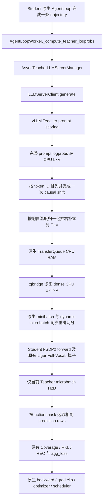

# Full-Vocabulary Coverage-Adaptive Agentic OPD

当前实现基于 veRL `3fdf2b548882a8aeccf0842c2150d9c9f1790a55`，使用原生异步
**vLLM Teacher + FSDP2 Student**。Student Full-Vocab 算子、Coverage、RKL、REC、
stop-gradient 和 optimizer cadence 延续上一版，数学模块和算子 patch 未改动。
逐文件变更及测试证据见 [交付报告](full_vocab_opd_delivery_report.md)。

## 数据流



每个 AgentLoop 的已完成 trajectory 在其 `_agent_loop_postprocess` 内立即发起
Teacher 请求，与 reward 并行；不同 session/prompt 不等待整个 rollout batch。
一个 AgentLoop 返回多条 trajectory 时，也逐条并发发起请求。请求调度、continuous
batching、chunked prefill 均由原生 vLLM 执行。上层未新增 Teacher queue/batcher。

Teacher 沿用 `MultiTeacherModelManager`、TeacherModelManager、原生 teacher_pool
和 LLMServerClient；该资源池现在只承载 vLLM replicas。当前 Full-Vocab 分支支持
一个 Teacher，可由原生配置分配多个 replicas。Student rollout 可选 vLLM/SGLang。

## vLLM 请求与输出

当前项目 pin 为 vLLM 0.32.0。每个请求将完整的未 padding
`prompt_ids + response_ids`（包括 tool observation）作为 prompt，实际参数为：

```python
{
    "max_tokens": 1,
    "temperature": 1.0,
    "prompt_logprobs": -1,
    "flat_logprobs": True,
    "detokenize": False,
}
```

Teacher engine 同时设置 `engine_kwargs.vllm.max_logprobs=-1`，
`inference.logprobs_mode=raw_logprobs`。`max_tokens=1` 保留原生 scoring API 的
最小生成占位；生成 token 不进入 Teacher 分布或训练数据，监督仅取 prompt scores。

vLLM 0.32.0 的 [SamplingParams](https://github.com/vllm-project/vllm/blob/v0.32.0/vllm/sampling_params.py)
支持上述 full/flat 请求；[ModelConfig](https://github.com/vllm-project/vllm/blob/v0.32.0/vllm/config/model.py)
允许 unrestricted logprobs。
[FlatLogprobs](https://github.com/vllm-project/vllm/blob/v0.32.0/vllm/logprobs.py)
通过 primitive arrays 传输。解码器直接读取 start/end indices、token_ids、logprobs，
避免调用会重建每行 dict 的索引方法。保留 dict fallback 以支持原生另一种返回表示。

服务端检查 request identity，并把每个 scored position 的所有 vocabulary ID 排回
`0..V-1`。允许 vLLM 重复返回被评分 token，但要求重复分数相同；缺 ID、非有限值、
不完整 collection、vocab 越界或 request 错配均明确报错。服务端从实际 model config
读取 V，不从 tokenizer 长度推测。

Prompt scores 不受 sampling temperature 影响。为保留上一版 temperature objective，
Manager 在 CPU 计算 `log_softmax(raw_prompt_logprobs / full_vocab_opd.temperature)`，
随后转为配置的缓存 dtype。最后一行是无 next prompt token 的零占位行。

## CPU dense 存储与 microbatch H2D

每条 Teacher 输出为 detached CPU `[L,V]`，右补零到 Student rollout 的配置容量
`T = prompt_length + response_length`。AgentLoop 将 `[T,V]` 写入同一 trajectory key
下的 `teacher_logprobs`，Full-Vocab 分支没有 `teacher_ids`。

TransferQueue 0.1.11 会将非 scalar 字段重新打包为 nested tensor，即使每条等长。
原生 `tqbridge -> _async_meta_to_realdata` 在读取后调用
`restore_dense_teacher_logprobs`，仅将无 `teacher_ids` 的 Full-Vocab 字段在 CPU 恢复为
`[B,T,V]`，检查 detached、CPU、rank 和相同容量。Top-K 字段沿用原有表示。
这是 TQ 读取表示的转换；缓存及其生命周期仍由原生 TQ 管理。

Teacher 字段和 sample 一起参与原生 TensorDict 索引、shuffle、minibatch 及 dynamic
microbatch reorder。`FSDPEngine.forward_step` 调用
`move_micro_batch_without_teacher`：只移动 Student 输入，Teacher 当前片段仍在 CPU。
Student forward 完成后，Full-Vocab loss 调用 `teacher_action_logprobs`，此时才移动
已经切好的 `[B_mu,T,V]`，转换为 FP32，并选择有效 action prediction rows。
不存在完整 train batch 的 Teacher `.cuda()`/`.to(cuda)`。

CPU payload 大约为 `B*T*V*sizeof(cache_dtype)`；服务端与传输还会有临时副本。
Student Full-Vocab 输出大约为 `4*N_mu*V` GPU bytes，loss/sort 另有临时开销。
本版接受 dense RAM 存储，不引入额外内存预算、memmap、磁盘缓存或请求 batcher。
`teacher_cache.dtype` 仅控制 CPU payload 精度，支持 float16/bfloat16/float32。
FP16 非有限值会报错，可改用更宽 dtype。原生 TQ 清理、checkpoint 行为保持原样。

## Causal alignment 与 mask

vLLM prompt score 的位置 j 表示 `p(token_j | tokens[:j])`，首位置没有评分。
服务端解码时执行一次 shift：`prediction_row[j-1] = prompt_score[j]`；最后补零。
因此 Teacher row i 表示 `p(. | tokens[:i+1])`。

Student 使用现有 `response_from_nested` 从同一个 prediction state 取 full logprobs。
对于 prompt 长度 P、response 内位置 r，双方都选择 `P-1+r`：第一 response token
对应 P-1，最后 response/EOS 对应 L-2。缓存右侧 padding 和最后 dummy 不参与 loss。

Tool/environment observation 保留在完整上下文内；`response_mask=0` 的位置不进入
Coverage/RKL/REC。最终 loss 按原有 `response_mask/loss_mask`、native `agg_loss`、
DP/global token denominator 聚合。synthetic padding 保持 Teacher 容量且 action mask
全零；即使 synthetic input 比 Teacher 容量长，也不会读取不存在的 prediction row。

## Student 算子与算法

现有 Student 调用链：

```text
PPOTrainer._update_actor
 -> ActorRolloutRefWorker.update_actor
 -> TrainingWorker.train_mini_batch -> train_batch
 -> FSDPEngine.train_batch -> forward_backward_batch -> forward_step
 -> prepare_model_inputs -> patched model forward
 -> FusedLinearForPPO(return_full_log_probs=True) -> patched Liger
 -> prepare_model_outputs
 -> distillation_ppo_loss -> distillation_loss registry
 -> compute_coverage_adaptive_full_vocab
 -> response_from_nested + teacher_action_logprobs
 -> coverage_adaptive_full_vocab -> native agg_loss
 -> native backward -> gradient clipping -> optimizer_step -> scheduler
```

`coverage_adaptive_full_vocab` 是独立 registry mode，`compute_topk_loss` 明确拒绝 Full-Vocab。
Student `full_log_probs` 保留 autograd，在当前 forward/loss 后从公共 engine outputs 移除。
Teacher 数据完全 detached。现有 exact teacher nucleus、mass-weighted coverage、线性 gating、
full-vocab RKL、包含 residual bucket 的 REC、FP32 数学和数值稳定规则保持不变：

\[
L_t=\alpha_R(C_t)L_t^{RKL}+\alpha_F(C_t)L_t^{REC}.
\]

Liger 0.8.4 patch 原样保留，仅 Student 训练需要它。Full-range selected IDs 仍走已有
portable GEMM/FP32-softmax autograd 实现；没有新增 SM90 原生 full-vocab 融合性能声明。
详见 [patch 安装与边界](../patches/liger/README.md)。

## 配置和运行

[示例 YAML](../examples/on_policy_distillation_trainer/full_vocab_adaptive_opd.yaml)
复用原生 `ppo_trainer` 和 Teacher inference 配置。Full mode 为
`distillation.execution_mode=full_vocab_vllm`。旧 `full_vocab_fsdp2`、`teacher_engine`、
`teacher_model_config`、Teacher inference microbatch/budget 配置已移除。

启动前设置下列变量。模型、数据及资源参数需要对应实际 GPU 机器，launcher 不硬编码资源数量。
Teacher/Student 的 token-to-ID mapping、special token IDs 及 runtime vocabulary width 必须一致。

| 必填环境变量 | 用途 |
|---|---|
| `OPD_STUDENT_MODEL`, `OPD_TEACHER_MODEL` | 两个模型路径 |
| `OPD_TRAIN_FILES`, `OPD_VAL_FILES` | veRL parquet 数据路径 |
| `OPD_STUDENT_NNODES`, `OPD_STUDENT_GPUS_PER_NODE` | Student 原生资源池 |
| `OPD_TEACHER_NNODES`, `OPD_TEACHER_GPUS_PER_NODE` | 原生 vLLM Teacher 资源池 |
| `OPD_TEACHER_TP_SIZE` | 每个 Teacher replica 的 TP |
| `OPD_TEACHER_MAX_BATCHED_TOKENS` | vLLM 原生调度 token 参数 |
| `OPD_TRAIN_BATCH_SIZE`, `OPD_MINI_BATCH_SIZE` | 原生 batch / optimizer minibatch |
| `OPD_STUDENT_MAX_TOKENS`, `OPD_OLD_LOGPROB_MAX_TOKENS` | Student 原生 dynamic token 参数 |

可选：`OPD_ROLLOUT_ENGINE=vllm|sglang`，`OPD_STUDENT_FSDP_SIZE=-1`，
`OPD_TEACHER_DP_SIZE=1`，`OPD_TEACHER_DTYPE=bfloat16`，`OPD_CACHE_DTYPE=float16`。
若通过 Hydra 设 `actor_rollout_ref.actor.use_dynamic_bsz=false`，还需设置
`OPD_STUDENT_MICRO_BATCH` 和 `OPD_OLD_LOGPROB_MICRO_BATCH`。
Teacher 没有 FSDP microbatch 参数。

在符合 veRL Main 依赖的 GPU 环境安装与启动：

```bash
cd /root/autodl-tmp/verl-full-vocab-opd
uv sync --extra fsdp --extra vllm
source .venv/bin/activate
bash patches/liger/install.sh
# 在当前 shell 导出上表中的模型、数据及硬件参数后：
bash examples/on_policy_distillation_trainer/run_full_vocab_adaptive_opd.sh
```

本次 `.venv` 用于 CPU 验证，生产 GPU 环境需安装对应 CUDA 依赖。执行 `uv sync` 后应
重新运行 Liger installer，以免恢复为未打 patch 的 upstream wheel。
配置可先用 launcher 的 `--cfg job --resolve` 检查。首次 GPU 单步可加：

```bash
bash examples/on_policy_distillation_trainer/run_full_vocab_adaptive_opd.sh \
  trainer.total_training_steps=1 trainer.total_epochs=1 \
  trainer.val_before_train=false trainer.test_freq=-1 trainer.save_freq=-1
```

回归命令、结果与 GPU 验证边界见 [交付报告](full_vocab_opd_delivery_report.md)。

当前无卡 2GB 环境的最终 CPU 回归：**130 passed, 21 skipped**，监测到的总 cgroup
内存峰值 **1560.8 MiB**；没有触发 OOM。真实 GPU 与完整 Ray transport 的未验证范围
见交付报告。不要在当前 2GB 无卡环境执行上面的 GPU 安装或训练命令。
